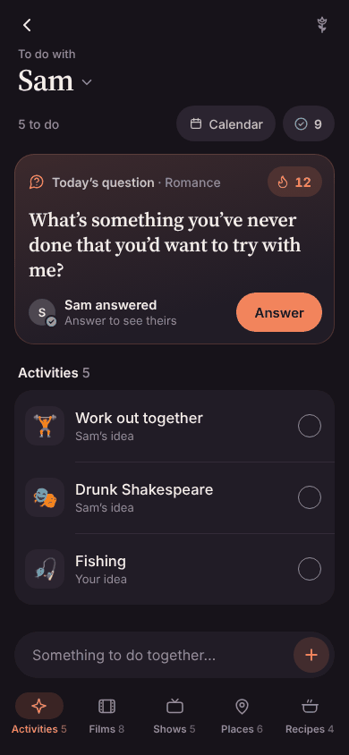
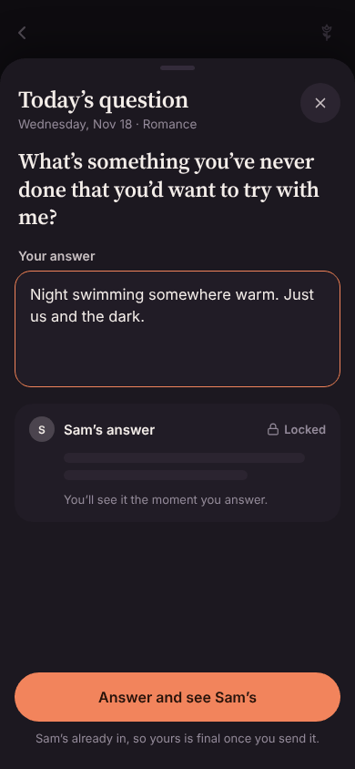
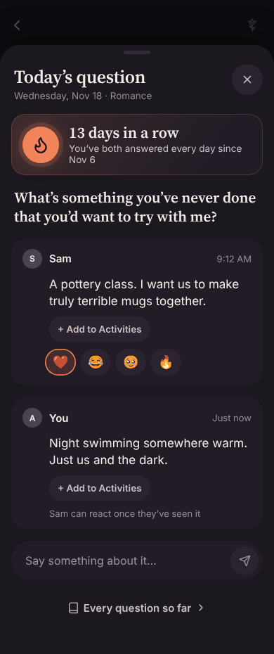
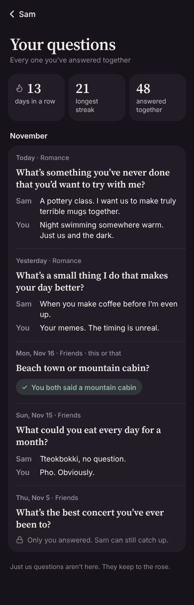
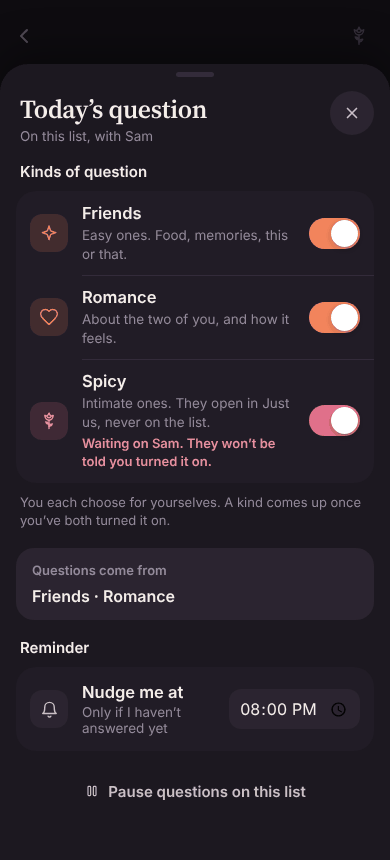
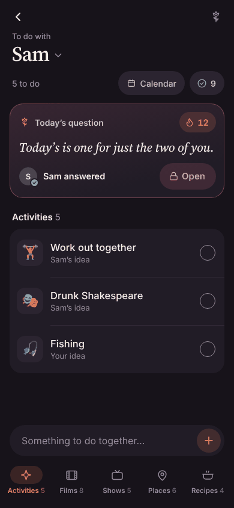
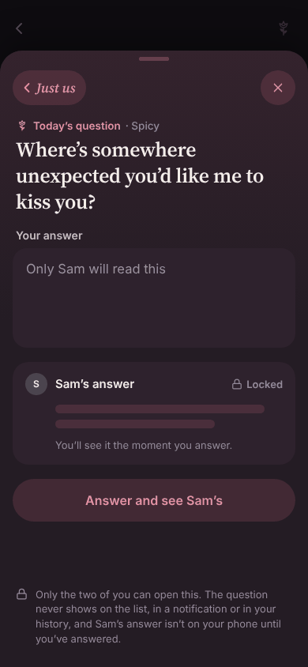

# Do With: Today's question

The design handoff for a daily question you keep with one person. You answer it to see
their answer, the two of you build a streak, and each of you picks which kinds of question
come up: Friends, Romance and Spicy. Spicy lives inside Just us and follows its rules.

- **Start with [HANDOFF.md](HANDOFF.md).** It is written for the Claude Code session that
  builds this, assumes `CLAUDE.md` has been read (the Just us and Nudges sections above
  all), and ends with a build order. Unlike the Just us redraw, this one is a server change
  too: a new pure module, its routes and its tests.
- **The questions:** [questions.md](questions.md) is a starter catalogue for all three kinds.
- **See it:** open [index.html](index.html) in a browser for every screen, with a
  Dusk / Forest toggle, or look below.
- **Source:** `mockup-src/` holds the design canvas's artboards. `screens/` is generated from
  them by `mockup-src/render.mjs`.

The partner in every mockup is a stand-in called Sam, and every answer is made up.

| | | |
|---|---|---|
|  |  |  |
| On the list | Answering | Both answers |
|  |  |  |
| Every question so far | Which questions | A Just us day, on the list |
|  | | |
| A Just us day, in the rose | | |
